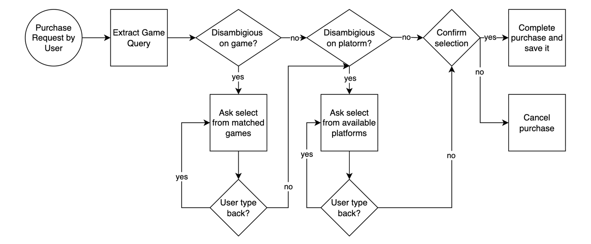
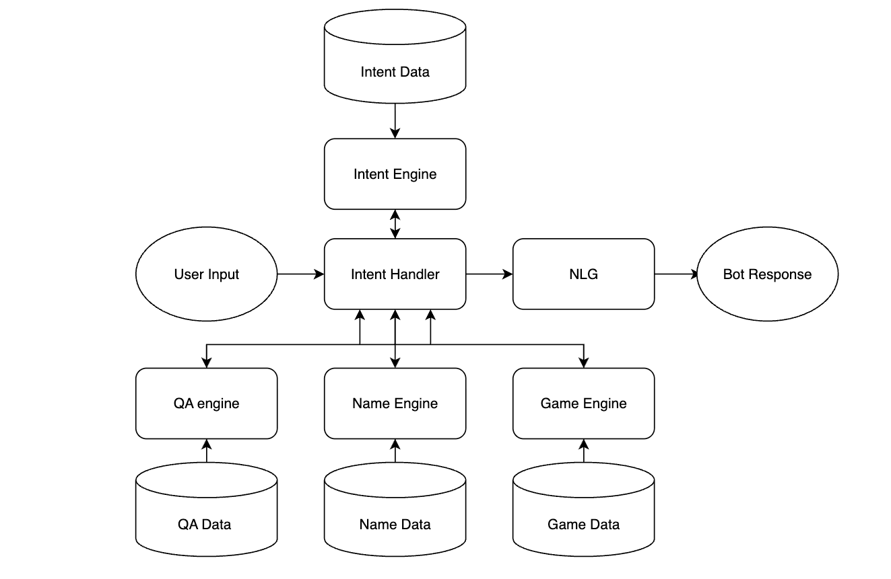

# Game Shop Chatbot

A text-based conversational assistant for a video game shop. Users can browse a catalogue of 6,600+ game listings, filter by platform, genre, price, critic score and release year, and complete a multi-turn purchase in natural language. The assistant also handles small talk, remembers the user's name if they agree to it, keeps search and purchase history, and suggests games based on past purchases.

The system is built with **classical NLP techniques only**: TF-IDF vectorisation, cosine similarity, regex-based extraction, explicit dialogue state and template-based responses. There are no LLMs, transformers or external AI APIs. It was developed for the COMP3074 Human-AI Interaction module at the University of Nottingham.

📄 **[Read the full project report](paper/20587851_Ali_Karaoglu_report.pdf)**

---

## Highlights

- **97.5% intent-classification accuracy** (weighted F1 0.975) across 49 intent categories
- **92% CUQ usability score** (Chatbot Usability Questionnaire)
- **Multi-turn purchase flow** with game and platform disambiguation, back-navigation and explicit confirmation
- **Structured game search** over title, platform, genre, price, critic score, release year, developer and publisher
- **Personalised recommendations** based on the genre and platform of the user's last purchase
- **Local persistence** of name, preferences, search history and purchase history
- **Fully deterministic and offline**: no external AI service is called

---

## Features

### Conversation and identity
- Greetings, small talk and a built-in help menu (`"what can you do?"`)
- Sentiment-aware follow-up: after `"how are you?"`, the bot responds differently to positive and negative replies
- Name management: introduce yourself, recall, change (implicitly or via an explicit flow) or remove your stored name
- Flexible name extraction: many intro phrasings (`"my name is…"`, `"call me…"`, `"I go by…"`), names of 1–5 words, accents, hyphens and apostrophes
- Optional persistence: at the end of a session the bot asks whether to remember your name next time

### Question answering
- Retrieval-based answers from a general-knowledge QA dataset (1,473 question/answer pairs)
- When a topic has several stored answers, one is chosen at random

### Game search and filtering
- Fuzzy title search (e.g. `"FIFA"` matches `"FIFA 23"`)
- Filter by **platform** and **genre** using alias dictionaries (`"playstation 4"` → `PS4`, `"rpg"` → `Role-Playing`)
- Filter by **price**, **critic score** and **release year**: below / above / exact / between
- Browse by **developer** or **publisher**
- Extremes: cheapest / most expensive, lowest / highest rated, oldest / newest
- List all available platforms and genres
- Large result sets are capped at 20 randomly sampled entries to keep output readable

### History and personalisation
- **Search history**: numbered, de-duplicated list; pick a number to re-run a search, or clear it
- **Purchase history**: view or delete recent purchases
- **Recommendations**: up to 10 titles that share the genre and platform of your most recent purchase, excluding games you already bought

### Purchase flow
1. Extract the game query from the user's request
2. If several titles match → choose one from a numbered list
3. If the title is on several platforms → choose a platform (with prices)
4. Confirm the order summary (`yes` / `no` / `back`)
5. Save the purchase to history

`back` steps up one level at any stage, and `"I don't want games"` leaves the flow entirely.

<p align="center">
  
</p>

---

## NLP architecture

<p align="center">
  
</p>

Each user turn passes through the **intent handler**, which is the central router and dialogue-state controller:

| Stage | Component | Technique |
|---|---|---|
| Intent classification | `engines/intent_engine.py` | TF-IDF (unigrams + bigrams) over hand-written intent examples, cosine similarity to the nearest example |
| Question answering | `engines/qa_engine.py` | TF-IDF (unigrams + bigrams, English stop words removed) over QA questions, cosine similarity |
| QA vs. intent routing | `intent_handlers/non_game_intents_handler.py` | Whichever of the QA score and the intent score is higher wins |
| Confidence handling | intent handler | Below 0.40 → fallback; 0.40–0.70 → clarification prompt restating the closest example; otherwise act on the intent. The intent engine itself rejects matches below 0.50 |
| Name extraction | `engines/name_engine.py` | NLTK tokenisation to align the input with the matched intro template, then a Unicode-aware regex for 1–5 name tokens |
| Game search | `engines/games_engine.py` | Separate TF-IDF models for titles, publishers and developers (fuzzy match threshold 0.40) plus structured comparisons for numeric filters |
| Slot extraction | `engines/games_detectors.py` | Regex and alias dictionaries (`config.py`) for platform, genre, prices, scores, years and numbered selections |
| Dialogue state | intent handlers | Explicit state flags for purchase stages, name-change and removal flows, goodbye flow, search-history selection and small-talk follow-up. Repeated unrelated input exits a multi-step flow instead of trapping the user |
| Response generation | `responses.py` | Template-based NLG with f-strings, personalised with the stored name |
| Persistence | `storage.py` | `joblib` files for name, name-saving preference, search history and purchase history |

---

## Evaluation

Results reported in the [project report](paper/20587851_Ali_Karaoglu_report.pdf):

| Metric | Result |
|---|---|
| Intent test utterances | 713 |
| Intent categories | 49 |
| Accuracy | **97.5%** |
| Weighted precision / recall / F1 | 0.980 / 0.975 / **0.975** |
| Macro F1 | 0.956 |
| Intents with F1 ≥ 0.95 | 41 / 49 |
| Structured multi-turn dialogue scenarios | 20, with no state-management failures |
| CUQ usability score | **92%** |

The weakest intents were `games_search_by_genre` (F1 0.667, recall 0.500) and `games_search_by_platform` (F1 0.741, precision 0.667). In both, phrasing overlaps with neighbouring search intents.

**Reproducing the metrics:** the test set in this repository ([`src/intent_test.csv`](src/intent_test.csv)) has 686 utterances across 47 intent labels. Running it gives the same headline figures: 97.5% accuracy, weighted P/R/F1 0.980 / 0.975 / 0.975 and macro F1 0.956, with the same two weakest intents. The CUQ survey and the dialogue scenarios were run manually and are not scripted in this repository.

---

## Setup

**Requirements:** Python 3.9+ (tested with Python 3.13).

```bash
git clone https://github.com/alimert05/nlp-based-chatbot.git
cd nlp-based-chatbot

python -m venv .venv
# Windows: .venv\Scripts\activate
# macOS/Linux: source .venv/bin/activate

pip install -r requirements.txt
```

The chatbot uses NLTK's `word_tokenize`, which needs the Punkt tokenizer data:

```bash
python -m nltk.downloader punkt_tab
```

(On NLTK versions older than 3.8.2, download `punkt` instead.)

---

## Usage

Start the chatbot from the project root:

```bash
python src/main.py
```

`cd src` followed by `python main.py` also works, because all data paths are resolved relative to the project root.

Example inputs:

```text
my name is Alex
what can you do?
show me games for PS4
show me rpg games
games under 20 pounds
games with rating between 8 and 9
games released after 2015
show me the cheapest games
games published by Nintendo
let me buy Minecraft
what did I buy?
recommend a game
search history
bye
```

User state is written to `data/joblib/` and created automatically on first use. Delete the `.joblib` files there to reset the bot to a first-time user.

### Running the intent evaluation

```bash
python src/test.py
```

This prints accuracy, a per-intent precision / recall / F1 report, the label order and the confusion matrix. To evaluate a different CSV with `text` and `true_intent` columns, pass `--path <file.csv>`.

---

## Project structure

```text
nlp-based-chatbot/
├── assets/                      # Diagrams used in this README
├── data/
│   ├── QA_data/                 # General-knowledge QA dataset (CSV)
│   ├── games_data/              # Game catalogue: title, platform, genre, price, score, ...
│   ├── intents/intents.json     # Intent tags and example utterances
│   └── joblib/                  # Runtime user state (git-ignored, auto-created)
├── paper/                       # Project report (PDF)
├── src/
│   ├── main.py                  # Entry point / REPL loop
│   ├── config.py                # Paths, platform and genre aliases
│   ├── storage.py               # Dataset loading and joblib persistence
│   ├── responses.py             # Template-based NLG
│   ├── test.py                  # Intent-classification evaluation
│   ├── intent_test.csv          # Labelled evaluation utterances
│   ├── engines/                 # Intent, QA, name and games engines + detectors
│   └── intent_handlers/         # Top-level router and game/purchase handler
└── requirements.txt
```

---

## Design choices

Classical NLP was a deliberate choice for this domain:

- **Deterministic:** the same input always produces the same routing, which makes the bot easy to test and debug
- **Interpretable:** every decision traces back to a similarity score, a threshold or a rule
- **Lightweight:** no GPU, no model downloads beyond NLTK's tokenizer, and fast start-up
- **Suited to small datasets:** TF-IDF works well with a few hundred hand-written intent examples
- **No hallucination in transactions:** templated responses guarantee that prices, titles and confirmations are always taken directly from the catalogue

---

## Limitations

- **Constrained domain:** the bot only understands the intents and phrasings it was given examples for
- **Overlap between similar intents:** bag-of-words similarity can confuse closely related intents, e.g. genre vs. platform search
- **Hand-maintained rules:** platform and genre aliases, and the regex patterns, must be updated by hand
- **Simple recommendations:** suggestions only match genre and platform of the most recent purchase
- **Single-user persistence:** `joblib` files are fine for a local prototype but not for concurrent or multi-user deployment

---

## Responsible design

- **Data minimisation:** only the name (optional), the name-saving preference, search history and purchase history are stored
- **User control:** the name is saved across sessions only with explicit consent, and users can change or delete it, and clear their search or purchase history, at any time
- **Local storage:** all user data stays on the local machine
- **Explicit confirmation:** purchases and changes to personal data require a yes/no confirmation
- **Predictable behaviour:** deterministic routing and templated responses avoid misleading or fabricated output

---

## License

Copyright © 2026 Ali Mert Karaoglu. All rights reserved.

This repository is made publicly available for portfolio and educational
reference purposes. No permission is granted to copy, redistribute, submit,
or reuse this work as academic coursework.

Please respect your institution's academic integrity policies.
